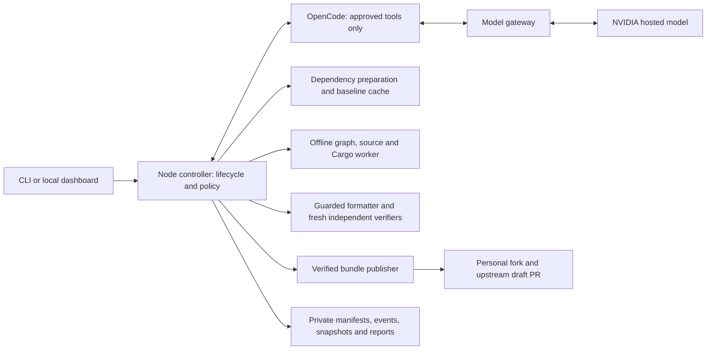

# Jarvis project handoff

> **Source integration — 27 October 2026:** this source now combines the reliability branch with the independently merged example-coverage work on `main`. Post-patch candidate review, final verified-diff summaries, profile testing notes, direct chat and bounded defective-test re-establishment coexist with the acceptance matrix, strict evidence, provider recovery and Activity/history improvements. Candidate review has its own read-only phase (approved checks, no edits/formatters); final description has no tools. Re-establishment preserves prior frozen source and submitted evidence, retains the acceptance matrix and stops after three replacements. Exact title citations require an explicit source; body remains the default. The detailed 21 October deployment and live-run observations below are historical: merging source does not rebuild or restart the running controller.

**Updated:** 27 October 2026, Asia/Kolkata.

**Repository:** [TechWizard9999/Jarvis](https://github.com/TechWizard9999/Jarvis).

**Publication branch:** `main` (merged with `improve/jarvis-reliability`).

**Personal project identity:** Pavan Saketh Ram, `pavan.sakethram@gmail.com`.

**Current stage:** locally deployed and tested Rust/Cargo issue-repair harness; autonomous repair reliability remains incomplete. The controller is idle. The latest real issue run stopped without a patch or PR.

This document describes implemented behavior, observed results and remaining work. Earlier design documents contain proposed features that are not present. Inspect the checkout and current configuration before continuing; run evidence does not establish that every future issue or upstream revision will work.

## 1. What the project does today

Jarvis accepts a GitHub issue, fetches a clean contribution baseline, creates an isolated source snapshot, uses a hosted model through OpenCode to inspect code and propose tests/changes, verifies the result in offline Docker containers, and can publish a verified draft PR through the user's fork.

The workflow and repository profiles are reusable. **The implemented language adapter is only `cargo-rust`.** RTK is the configured real-world target; arbitrary JavaScript, Python or other projects need additional adapters. Profiles configure upstream, branch, package, source/test roots and trusted checks. The prompts load issue and repository data dynamically; no #4684/#4596 solution is hardcoded into the live workflow. Some regression fixtures intentionally contain historical examples and are not supplied to live model turns.

The active model is NVIDIA Nemotron Ultra through NVIDIA's direct hosted endpoint. One configured model performs repair and a fresh read-only coverage review in separate sessions. Nebius integration, automatic Ultra/Lightning routing and a two-model peer protocol remain unimplemented.

## 2. Architecture and source map



| Area | Main files |
| --- | --- |
| Setup, configuration and trusted repository profile | `bugfix`, `scripts/setup.py`, `compose.yaml`, `src/config.ts`, `src/profile.ts`, `profiles/rtk.json` |
| Run orchestration, cancellation and admission | `src/pipeline.ts`, `src/lifecycle.ts`, `src/github.ts`, `src/competing.ts` |
| Phase prompts, sessions and tool bridge | `src/agent.ts`, `opencode/bugfix.ts` |
| Hosted request controls, streaming and recovery | `src/server.ts`, `src/provider.ts`, `src/provider-stream.ts`, `src/provider-health.ts`, `src/agent-recovery.ts` |
| Planning, test freeze and verification | `src/planning.ts`, `src/acceptance.ts`, `src/coverage-review.ts`, `src/evidence.ts`, `src/policy.ts`, `src/rust.ts`, `src/checks.ts` |
| Sandboxes, source identity and publication | `src/docker.ts`, `src/git.ts`, `docker/*`, `src/publication.ts` |
| Durable activity, transcript and UI | `src/store.ts`, `src/transcript.ts`, `src/report.ts`, `public/*` |
| Reproducible local release gates | `scripts/verify.mjs`, `tests/*`, `scripts/*e2e*` |

The [six architecture diagrams](docs/JARVIS-ARCHITECTURE.md) and [HTML viewer](docs/architecture/index.html) preserve the earlier `d3c00624` snapshot. Their retry-gap discussion is historical. Use this handoff and the [provider](docs/PROVIDER-RECOVERY.md) and [planning](docs/PLANNING-RECOVERY.md) contracts for the later changes.

## 3. Changes completed in this work

| Change | Implemented behavior |
| --- | --- |
| Terminal-like Activity scrolling | Follow new events at the bottom; preserve position while scrolled up; resume following at the bottom. Execution continues independently of scrolling. |
| Large-run monitoring | Cursor-based history paging/search, bounded rendered rows, one active event stream, unread/follow controls, event evidence and transcript reconciliation across reconnects. Browser fixtures cover 100,000 events. |
| Acceptance and reproduction | An issue-grounded matrix precedes edits. New tests must establish all required behaviors and existing controls. Failed baselines must be assertion failures three times, with no zero-match or compilation/setup success claims. |
| Planning recovery | Validate every row and citation; preserve every submitted answer and all validation errors; permit at most three submitted model plans, read-only. Invalid operator matrices are not rewritten. Exhaustion reports `needs_attention`, not `cannot_reproduce` before testing. |
| Correct phase instructions | Initial high-effort planning no longer assumes frozen tests exist. The later independent coverage review retains its separate read-only contract. JSON-format exhaustion is typed and stops initial planning instead of restarting indefinitely. |
| Test integrity and formatting | Preserve original submissions; format in a guarded scratch tree before freezing integration-file hashes. Protect production, existing tests, helpers, manifests, CI and frozen fixtures. |
| Reproduction admission | Discover canonical Cargo artifacts/tests; admit the draft against trusted checks, excluding only exact new expected-failing scenarios. Existing tests and passing controls must pass. |
| Coverage and candidate evidence | Fresh review must cite direct assertions and current source evidence. Candidate proof must include a current source read and an exact passing frozen bug test. Independent verification remains the publication gate. |
| Recovery and preservation | Keep rejected source/answers/checkpoints before rollback or stop. Detect repeated unchanged failures; preserve verified-but-unpublished results for explicit publication retry. Live evidence shows these progress guards still miss costly loops. |
| Provider correctness | Separate HTTP transport from generation success; detect structured JSON/SSE errors, interrupted streams and explicit completion; handle UTF-8/CRLF/multiline framing; retain safe request IDs and rate headers. |
| Provider retry policy | At most four consecutive transient attempts per logical request; shared Retry-After cooldown; repeated unchanged provider failures pause recovery. Partial delivered output stops automatic replay. Productive work has no aggregate token/tool/time budget. |
| Endpoint compatibility | Persist exact endpoint/model observations of the unsupported Ultra numeric reasoning budget. Omit only that parameter after the exact validated incompatibility; retain thinking, effort and output caps. A generic 500 never authorizes stripping parameters. |
| Lifecycle/publication | One admitted operation; immutable run configuration and publication identity; competing PR detection; verified bundle/tree and actual PR readback, including uncertain-create reconciliation and CI-status distinctions. |
| Local environment | Pinned toolchain/images, credential separation, worker init handling, controller image packaging and personal commit identity were configured and exercised. |

Implementation history, all authored/committed with the personal email above:

| Commit | Purpose |
| --- | --- |
| `3fbf2b3` | Preserve existing local setup before reliability changes. |
| `92366bb` | Acceptance, execution reliability, evidence and monitoring improvements. |
| `337dba0` | Model controls and reproduction admission. |
| `d3c0062` | Include Compose defaults in the controller test image. |
| `d1fbeb8` | Stream/error handling, durable endpoint capabilities and bounded provider recovery. |
| `c4dc725` | Correct planning instructions and bounded semantic planning recovery. |

The subsequent handoff/architecture publication commit changes documentation only. The deployed runtime source remains `c4dc7252c0d016d0854851d591b48c1a5a562c43`.

## 4. Current local deployment and settings

| Setting | Current value |
| --- | --- |
| Runtime release | `evaluation/harness-20261021-planning-recovery` |
| Controller source hash | `677e4d2b993bd5810719ff5e3dd39da96648bd2587851925e1756b7e66a2edcf` |
| Controller image | `sha256:b2490083ae1067b46df64e766da9b7b2b3a0869cbba76f5f90b1bf08d134d0a9` |
| Controller Node | 24.22.0 |
| Default model | `nim/nvidia/nemotron-3-ultra-550b-a55b` |
| Endpoint | `https://integrate.api.nvidia.com/v1/` |
| Context / working input | 262144 / 196608 tokens |
| Critical output / compaction reserve | 24576 / 8192 tokens |
| Thinking | High effort during planning, reproduction, coverage review and patching; medium discovery; thinking off for reply-only formatting. |
| Sampling | Temperature 1, top-p 0.95. |
| Numeric reasoning budget | Requested as 16384 on critical turns; currently omitted for the exact Ultra endpoint/model due to validated unsupported-runner behavior. There is no enforceable separate answer reserve when omitted. |
| Repository | `rtk-ai/rtk`, contribution branch `develop`, `cargo-rust` profile. |
| Fork and identity | `PavanaSakethaRam/rtk`; personal name/email above. |

Context/output values are configured capacities, not proof every request uses that size. Direct research separately accepted larger input and a 32768 output allowance; production remains at the user-selected 256K context and 24576 output cap. Free hosted access does not establish unlimited throughput. Provider 429s remain external limits.

The RTK profile documents one skipped upstream test that writes into the read-only source mount. The skip and owning file are explicit; readiness applies to the exact base/profile/images checked.

## 5. Current result and previous live observations

### Latest run: #4684

Run `20261021071824-7e68867a`, upstream base `5ab6291365e9d14f486a89d04af6b7da6710105c`:

- Started **21 October, 12:48:24 IST**; ended **14:39:46 IST**, about **1h 51m 22s** later.
- Terminal result: **`needs_attention` in reproduction**. No accepted frozen regression matrix, patching phase, verified commit or PR.
- Planning recovery worked live: two citations were rejected on the first plan; the model corrected them and the second eight-row matrix was accepted.
- Both completed reproduction submissions changed the main requirement from its frozen integration target to a unit target. Both were rejected. The third attempt stopped before submission.
- Some test failures were invalid setup: a fixture used nonexistent TOML `rstrip_lines`. A supposed passing control also required the whitespace bug fix, so it failed on the unchanged baseline. Repeated invalid file creation and selectors consumed substantial work.
- Final trigger: an HTTP200 upstream body ended after partial output without semantic completion. The gateway stopped automatic replay. The exact underlying provider/network cause is unproven; the final stop was not a status inspection or deliberate tool-recovery interruption.
- **492 logical requests / 937 outbound attempts:** 448 HTTP200, 488 HTTP429, one HTTP502, zero HTTP500. **455 tools:** 367 results, 88 rejections. **124 checks:** 53 passed, 60 failed, 11 no-match. These include repeated and invalid checks, not 124 independent validated scenarios.
- **21,612,383 reported tokens** include repeated contexts; missing usage remains unknown. This is not unique generated output or a billing estimate.

Partial tests/source and original evidence remain preserved locally. The primary RTK checkout is clean and the controller was healthy at the last inspection. No new repair is active.

### Other relevant observations

| Observation | Result and interpretation |
| --- | --- |
| #4596 run `20261021063234-f87d172c` | Stopped during planning on an invalid citation, before tests. Historical `cannot_reproduce` was a classification defect, not proof the bug was unreachable. 56 logical requests, 130 attempts, 81 HTTP429, zero recorded HTTP500. |
| First #4684 run `20261021064624-9daac6fd` | Same planning defect; 22 logical requests, 43 attempts, 23 HTTP429, zero HTTP500, zero checks. This led to `c4dc725`. |
| Earlier #4596 experiment | Cancelled after substantial work and a prefreeze-formatting conflict. Preserve as a censored diagnostic; it is not a completed repair or valid model-ranking sample. |
| Direct Ultra capability tests | High effort/thinking accepted. Actual input tests of 228163 and 1015163 tokens retrieved three distant canaries. This is a retrieval observation, not general long-context reasoning proof. |
| Standalone medium coding task | First unedited scheduling solution passed 504/504 hidden oracle checks in offline Docker. One problem does not establish overall repair accuracy. |
| Ultra/Lightning and graph/text comparisons | Full controlled end-to-end comparison remains unperformed; harder #4618 remains held. |

Earlier RTK contribution work is separate from this Jarvis branch: [PR #4666](https://github.com/rtk-ai/rtk/pull/4666) and [PR #4669](https://github.com/rtk-ai/rtk/pull/4669) were corrected/validated and opened for review. At this handoff both are open, non-draft, unmerged and one commit each. [PR #4682](https://github.com/rtk-ai/rtk/pull/4682) remains a draft; independent review found timing regressions despite local checks. None is a claim that the latest #4684 run succeeded.

## 6. Validation and its limits

The deployed planning release passed strict TypeScript, **305 unit tests**, Activity and Monitoring browser fixtures, real offline Docker/Cargo/Git fail-to-pass verification, real pinned OpenCode with a scripted provider, and publisher tests using mocked GitHub plus a local bare remote. The packaged Node24 controller separately passed 305 tests; all 78 packaged TypeScript files matched the tested source. Setup/health checks passed. A publication-time rerun is recorded at the top of [TESTING.md](TESTING.md).

Local fixture gates establish harness behavior. They do not establish successful NVIDIA repair of every real issue, upstream CI execution, model superiority or universal repository support. The latest live failure is a material limitation despite green local tests.

## 7. Next work, in priority order

| Priority | Problem | Recommended implementation and validation |
| --- | --- | --- |
| P0 | Repeated acceptance/test-target drift | Return exact expected/submitted baseline, required and target fields before discarding useful work. Add recorded mismatch regressions, require the complete matrix and retain independent verification. |
| P0 | Infeasible or overconstrained plans | Review scope and controls before freeze. Distinguish observable issue behavior from a chosen configuration/API implementation. A passing control must work on the baseline. Do not automatically weaken requirements to obtain a pass. |
| P0 | Costly ineffective loops | Track repeated file-creation, fixture-setup and selector failures across sessions/resets. Count semantic progress rather than treating reads, formatting or fresh source hashes as sufficient. Preserve checkpoints and stop honestly without reinstating an aggregate work budget contrary to the user's preference. |
| P1 | Failure classification | Separate test setup/compilation from behavior failures. Deliberate recovery aborts currently can appear as provider internal errors in fallback diagnostics; fix without misclassifying genuine upstream failures. |
| P1 | Incomplete streams and SDK retry multiplication | Test interrupted reasoning-only and actual tool/content streams separately. Make recovery ownership explicit, never replay uncertain partial tool execution, and keep unknown cause/usage explicit. |
| P1 | Live evaluation quality | After the above fixes pass recorded-fixture and integration gates, run one fresh easy issue without operator acceptance or fix hints. Inspect actual code/tests/PR. Freeze settings and environment before controlled model/retrieval comparison. |
| P2 | Broader product scope | Add other language/hosting adapters and true peer-model/Nebius integration only as separately scoped work. Current implementation must continue to advertise Rust/Cargo limitations. |

## 8. Operating and development commands

Normal operation needs Docker, Git, Python3 and a POSIX shell. Development gates additionally need Node24+, installed package dependencies, Chrome/Playwright and Docker access. On macOS, `fix` keeps the Mac awake while the CLI follows the run.

To obtain this published development snapshot in a new checkout:

```sh
git clone --branch main https://github.com/TechWizard9999/Jarvis.git
cd Jarvis
```

```sh
./bugfix doctor
./bugfix list
./bugfix tail RUN_ID
./bugfix cancel RUN_ID

# Starts real model inference; default fix publishes only after verification.
./bugfix fix https://github.com/rtk-ai/rtk/issues/NUMBER --repo /absolute/path/to/repos/rtk
# Use --no-publish for an explicitly local verified result.

pnpm install --frozen-lockfile --ignore-scripts
pnpm check
pnpm test
node scripts/verify.mjs
pnpm audit --prod
```

Use [SETUP.md](SETUP.md) for a new installation. `./bugfix up` prints a private dashboard token URL; keep that output private. For a controlled rebuild/restart, ensure no repair is active, build the controller, then `docker compose up -d --no-deps controller`; restart recovery marks unfinished execution interrupted rather than silently replaying it. Verify packaged tests/health after changing the runtime image.

Keep credentials in `.secrets/` and private configuration in `.env`; neither is committed. Do not overwrite credentials or private state during updates. Preserve `state/provider-capabilities.json`: it contains exact observed capabilities, not secret keys, but remains local and should be revalidated deliberately after endpoint changes. Do not commit raw event logs, private reasoning, snapshots, target clones or tokens. The trusted controller mounts the Docker socket; keep its authenticated UI bound to localhost rather than exposing this development deployment publicly.

### Local checkout layout

The deployed project is at the user's local `Jarvis` workspace. Its committed development clone is `state/implementation-20261020`; use its merged `main` for current source. The root runtime files preserve the previously deployed 21 October snapshot; root Git metadata still reflects the earlier base and shows the deployed changes as a working diff. This layout was used because root Git metadata is read-only in the current execution permissions. Use the committed development clone for history/pushes; do not reset the root deployment or delete its ignored state to make Git status appear clean.

The publication includes source, tests, setup/configuration templates, historical diagrams and this handoff. `.env`, `.secrets/`, `state/`, `repos/` and dependencies remain private/local. Untracked `graphify-out/` in the development clone is an AST navigation aid, not published source.

## 9. Local evidence index

These files are in the existing private workspace and intentionally absent from GitHub. The important results are summarized above so this handoff is useful without them.

| Artifact | Contents |
| --- | --- |
| `state/live-evaluation-20261020/CURRENT.md` | Current operational handoff and preserved history. |
| `state/planning-recovery-deployment-20261021.json` | Deployed source/image/file hashes and packaged test result. |
| `state/planning-recovery-deployment-source-20261021.json` | Prior source backup and scoped copy receipt for rollback. |
| `state/planning-recovery-final-20261021.md` | Planning defect diagnosis, implementation and validation. |
| `state/provider-recovery-final-20261021.md` | Provider compatibility and recovery validation. |
| `state/nemotron-validation-20261021/report.md` | Controlled context/thinking and medium-task observations. |
| `state/4684-retry-run-review-20261021.md` and `.json` | Latest run postmortem and structured counts. |
| `state/runs/20261021071824-7e68867a/` | Original manifest, events, accepted plan, rejected reproduction submissions, partial tests and logs. |
| `state/4596-cleanup-20261021T063216Z/` | Verified bundle/patch archives preserved before removing old #4596 worktrees/branches. |

**Immediate starting point for the next developer:** read this handoff, the planning/provider contracts and the latest run review; fix reproduction contract feedback and progress detection with recorded local fixtures before spending another long live run. Preserve the existing evidence and strict verification/publication boundaries.
