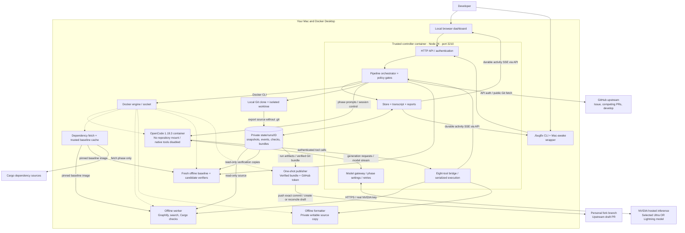
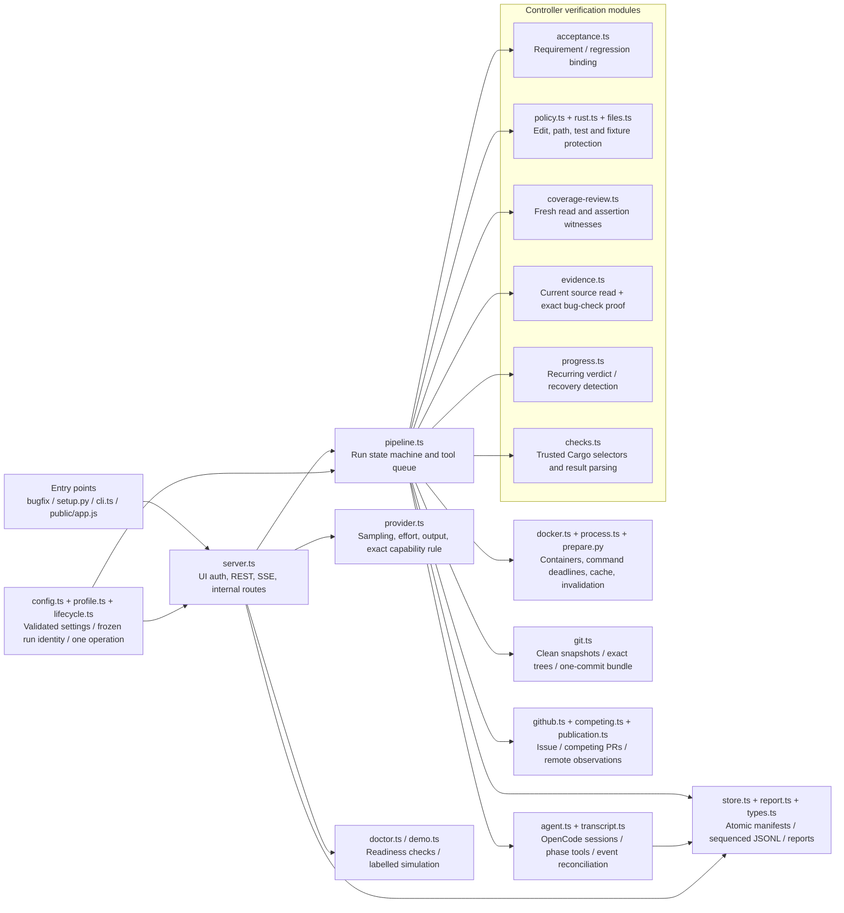
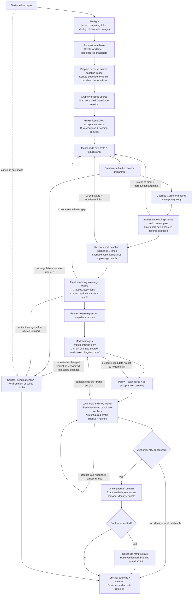
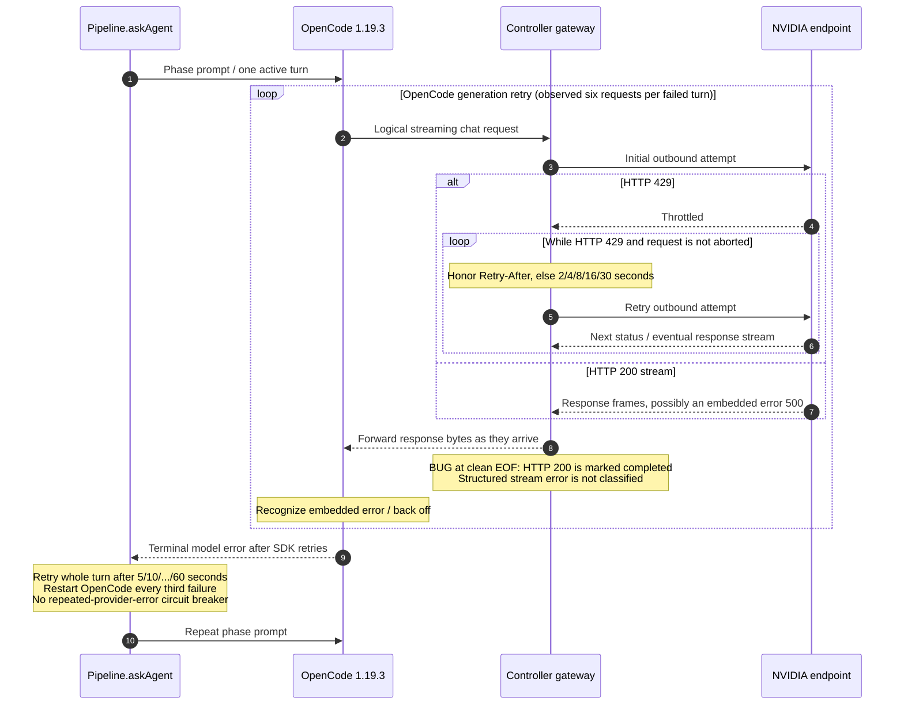
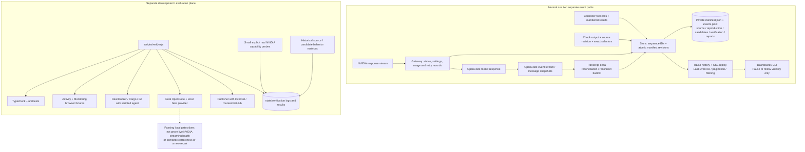
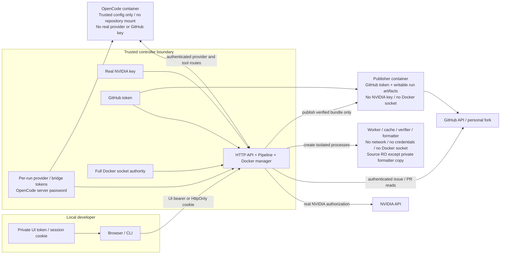

# Jarvis: complete project architecture

Historical snapshot inspected on **21 October 2026 (IST)**. Runtime source release at that inspection: `evaluation/harness-20261021-balanced-models-r2`; implementation commit `d3c00624c48a024db1bd4eab31a1226505229247`; controller source hash `4e13f75f0712eb553aafeae635f062e795d63a37cf31094388032176a15f66a4`. For the current deployed changes and project stage, start with [the project handoff](../CODEX_HANDOFF.md).

This document describes implemented behavior and marks observed gaps explicitly. The original handoff's Nebius integration and automatic two-model workflow are not implemented. One configured NVIDIA model is selected; the fresh coverage critic uses that same model in another session. Only the `cargo-rust` repository adapter is implemented.

> **Historical architecture snapshot:** the diagrams below describe release `d3c00624` before the provider recovery fixes. Release `d1fbeb88` corrects structured-stream error detection, persists validated endpoint capabilities and bounds repeated provider failures. See [current provider recovery behavior](PROVIDER-RECOVERY.md) and [the live validation report](../state/nemotron-validation-20261021/report.md). The container and repository trust boundaries remain as documented.

## Start here

1. System / containers / external services.
2. Controller module map.
3. End-to-end repair lifecycle.
4. Retry loop and current error gap.
5. Durable evidence, UI and validation tools.
6. Credentials and trust boundaries.

Editable Mermaid sources and rendered SVGs are under [architecture/](architecture/). The companion [diagram viewer](architecture/index.html) contains all six rendered diagrams. No secret values are included.

## Why rate limiting is frequent

There are two contributors: upstream NVIDIA throttling, and repeated requests generated by uncoordinated failure recovery. NVIDIA describes its hosted API Catalog as a prototyping service with limits that vary by model and concurrent load; the account page is the source for the account's allowance. Free access does not mean unlimited throughput. [NVIDIA NIM FAQ](https://forums.developer.nvidia.com/t/nvidia-nim-faq/300317).

The latest cancelled run `20261020185052-a7378899` lasted 6m31.874s and made **27 logical requests / 35 NVIDIA attempts**: **8 HTTP 429s** and **27 HTTP 200 streams subsequently rejected by OpenCode with embedded error 500**. There were **zero overlapping logical requests, zero tools and zero tests**. Token usage was unknown, not proven zero. The principal failure was repeated generation errors, with throttling during those retries.

The older 4h44m run `20261020130916-848f65ac` made 1175 logical requests / 2004 attempts and received 829 HTTP 429s. It did perform 1203 tool calls and reported 63,310,474 known tokens. Those input counts include repeated context; they are not unique generated output or a billing estimate. Different harness/settings and outcomes prevent a controlled model comparison.

### What the architecture contributes

| Finding | Consequence |
| --- | --- |
| Gateway retries every HTTP 429 until cancellation/disconnect | A throttled request can keep waiting and retrying indefinitely. |
| OpenCode retries generation errors, then Pipeline retries the whole failed turn | Repeated failure can regenerate the same prompts across several recovery layers. |
| Backoff resets for each new logical request; no shared provider cooldown or jitter | Recovery layers do not share one view of provider pressure. |
| No circuit breaker for repeated provider-only errors without progress | Tool/check progress guards cannot stop a run that never reaches a tool. |
| Gateway marks a cleanly ended HTTP 200 stream completed without checking structured error frames | The UI can show `model_finished` while OpenCode reports an embedded 500. |
| Safe rate-limit headers and per-attempt errors are not fully retained | The logs cannot identify which exact quota or capacity rule caused each 429. |

The browser's status polling and activity SSE do not call NVIDIA. Graphify extraction is code-only with its model backend disabled. Normal operation admits one run, rejects overlapping agent turns and serializes tools; this is not intentional parallel model fan-out. Larger context/longer reasoning can increase per-request work, but configured 256K capacity is not evidence that every request sent 256K tokens or that this caused these 429s.

### Improvements, in priority order — proposed, not deployed

1. **P0: Normalize structured stream errors.** Preserve transport status separately from logical model success, detect SSE/JSON error frames, and mark failed responses accurately. Never infer failure from arbitrary assistant text.
2. **P0: Add a repeated-provider-failure circuit breaker.** Same endpoint/model/settings/error with no usable answer or tool progress should yield an actionable attention state. Preserve the source and evidence. This is separate from a total token/tool/run-time budget.
3. **P0: Validate the actual streaming path.** Same tool catalog and generation settings as the repair, with recorded streamed-error regression cases. The prior live capability smoke was non-streaming; the adapter gate used a scripted endpoint.
4. **P1: Coordinate retry ownership.** Gateway owns provider throttling/cooldown; avoid multiplying SDK and whole-turn retries. Share endpoint/account cooldown across new requests, honor Retry-After, and jitter fallback delay without retrying earlier than requested.
5. **P1: Record safe attempt metadata.** Logical request ID, actual attempt, retry owner, error code, duration, provider request ID and allowlisted rate/reset headers. Unknown usage stays unknown.
6. **P2: Reduce repeated context and unnecessary session resets.** Preserve useful task checkpoints and avoid restarting discovery for provider outages. Keep correctness gates and the user-selected 256K capacity.

The current numeric reasoning-budget fallback recognizes one exact HTTP 400 error. All 27 requests in the latest cancelled run still sent `reasoning_budget=16384`; no fallback occurred. An unsupported budget is a possible trigger for the generic 500, but the logs do not establish it. Do not silently strip parameters on every generic server error or switch models without recording the experiment change.

## System and deployment

The controller is one Node service. Worker, formatter, verifier and publisher containers are created per operation; they are not separate always-running web services. Dashed arrows show container lifecycle control. The baseline fetch step has network access; the cache check/build step and repository execution do not.



[Open full-size SVG](architecture/01-system.svg) · [Mermaid source](architecture/01-system.mmd)

## Controller modules

These boxes are code modules in the same controller process, not independently deployed services. The controller owns real tool execution; the model proposes calls and receives numbered evidence.



[Open full-size SVG](architecture/02-controller-modules.svg) · [Mermaid source](architecture/02-controller-modules.mmd)

## Repair lifecycle

The persisted UI stages are queued, preflight, environment, discovery, reproduction, patching, verification, publishing and complete. Read-only review and JSON reply-format are finer turn purposes, not additional persisted stages. Cargo source formatting is a trusted worker command; JSON reply-format is a model turn with tools disabled.



[Open full-size SVG](architecture/03-repair-lifecycle.svg) · [Mermaid source](architecture/03-repair-lifecycle.mmd)

## Current retry architecture and failure path

This shows the observed failure path, including a known classification bug. The retry loops are serial and nested. A successful restart can reveal provider recovery, but does not fix the missing stream-error detection or retry coordination.



[Open full-size SVG](architecture/04-model-retries.svg) · [Mermaid source](architecture/04-model-retries.mmd)

## Evidence, activity and separate validation tooling

Model generation streaming and dashboard activity streaming are different paths. Scrolling up pauses viewport following only. Background execution and durable capture continue. Reconnect restores message state; intermediate OpenCode tool/status events can remain a reported coverage gap.



[Open full-size SVG](architecture/05-evidence-and-validation.svg) · [Mermaid source](architecture/05-evidence-and-validation.mmd)

## Credentials and trust boundaries

The controller is the trust root and has broad Docker authority. OpenCode uses the ordinary control network; native tools and its provider route are constrained by configuration and controller checks. It is not physically network-isolated. The publisher receives the whole writable run-artifact mount, not only the bundle.



[Open full-size SVG](architecture/06-credential-boundaries.svg) · [Mermaid source](architecture/06-credential-boundaries.mmd)

## Technology and configuration

| Layer | Current source declaration |
| --- | --- |
| Controller | Node 24, native ESM/TypeScript, built-in `node:http`; Docker 29 CLI |
| UI | Plain HTML/CSS/JavaScript; local loopback port 3210 |
| OpenCode | `opencode-ai` and plugin 1.19.3; OpenAI-compatible adapter |
| Worker | Rust 1.99.1; Git 2.56.0; Graphifyy 0.9.92; Cargo + Clippy + ripgrep |
| Publisher | Node 24, Git and GitHub CLI; distro Git/gh versions not pinned in Dockerfile |
| Development checks | TypeScript 5.9.3; Playwright 1.62.1; Node test runner |
| Persistence | Private filesystem snapshots, atomic JSON manifests and append-only sequenced JSONL; no application database |
| Current model | `nim/nvidia/nemotron-3-ultra-550b-a55b`; Lightning selectable by configuration, no automatic routing |
| Limits | Context262144 / working input196608 / output24576 / compaction reserve8192; threshold188416 counted tokens |
| Phase policy | Ultra discovery medium/8192 output; critical high/24576; JSON reply-format thinking off/2048 |
| Reasoning budget | Requested4096 discovery /16384 critical where supported; exact known rejection can omit it, with reserve unavailable recorded |
| Work budgets | No total run token/tool/time budget; per-command timeout and per-request limits remain; reproduction has6 attempts |

These are configuration capacities and source pins, not a full-context stress test or an accuracy guarantee. Source declarations and the last deployment receipt are distinct from a fresh runtime version inspection.

## Complete source ownership map

| Responsibility | Files |
| --- | --- |
| Host setup, clone, build, launch and Mac-awake wrapper | `bugfix`, `scripts/setup.py`, `.env.example`, `compose.yaml` |
| CLI API commands and event following | `src/cli.ts` |
| HTTP, auth, REST, provider proxy, tools, static UI and SSE | `src/server.ts` |
| Pipeline stages, admission, repair, verification, cancellation and publication | `src/pipeline.ts` |
| Phase-specific OpenCode contracts, sessions, events and JSON reply retries | `src/agent.ts` |
| Eight OpenCode custom tools and controller HTTP bridge | `opencode/bugfix.ts`, `docker/opencode-entry.mjs` |
| Model output/effort/budget policy, exact capability detection and retry delay | `src/provider.ts` |
| Config/profile validation, operation admission, captured run config and identity | `src/config.ts`, `src/profile.ts`, `profiles/rtk.json`, `src/lifecycle.ts` |
| Docker containers, cached baseline, source revision invalidation and command execution | `src/docker.ts`, `src/process.ts`, `docker/prepare.py`, `docker/*.Dockerfile` |
| Git snapshots, clean-source provenance, exact tree, signed-off commit and bundle | `src/git.ts` |
| Source path safety, inventory/hash, copying and exact edits | `src/files.ts` |
| Protected source/test/fixture rules and Rust test extraction | `src/policy.ts`, `src/rust.ts` |
| Acceptance requirement/scenario binding and expected fail/pass rules | `src/acceptance.ts` |
| Fresh clause/assertion/read witnesses | `src/coverage-review.ts` |
| Current candidate source-read and exact bug-check evidence | `src/evidence.ts` |
| Repeated checks/verdicts, immutable-offender and recovery diagnosis | `src/progress.ts` |
| Issue retrieval, competing PR discovery and remote PR observations | `src/github.ts`, `src/competing.ts`, `src/publication.ts` |
| Atomic manifests, durable event sequencing, paging and replay | `src/store.ts` |
| OpenCode text/reasoning delta reconciliation and reconnect backfill | `src/transcript.ts` |
| Internal and maintainer-facing reports | `src/report.ts` |
| Verified push / draft creation / idempotent reconciliation | `docker/publish.mjs` |
| Dashboard activity, diff, checks, usage, reports and scroll following | `public/index.html`, `public/app.js`, `public/style.css` |
| Prerequisite checks / explicitly simulated demo | `src/doctor.ts`, `src/demo.ts` |
| Shared runtime shapes | `src/types.ts` |
| Release gates and browser / Cargo / adapter / publisher fixtures | `scripts/verify.mjs`, `scripts/*e2e*`, `tests/*.test.ts` |
| Baseline readiness and historical/offline behavior evaluation | `scripts/readiness.ts`, `scripts/historical-e2e.ts`, dated `state/` research scripts |

Research scripts under `state/` are not automatically executed services. The prepared model/retrieval comparison and Nebius handoff ideas are not runtime components.

## API and streaming boundaries

| Route family | Caller and purpose |
| --- | --- |
| `/`, static UI | Authenticated local developer; UI token exchanged for HttpOnly SameSite=Strict cookie |
| `/api/status`, `/api/doctor`, `/api/demo` | Status, prerequisites, deliberately labelled simulation |
| `/api/runs`, `/api/runs/:id` | Start/list runs and read manifests |
| `.../events`, `.../history`, `.../diff`, `.../artifact` | Durable activity stream, paging, diffs and allowlisted private evidence |
| `.../cancel`, `.../publish`, `.../interventions` | User cancellation, verified publication retry and operator notes |
| `.../publication` | Idle/terminal run's remote PR/head/check/review observations |
| `/provider/:id/v1/models`, `/provider/:id/v1/chat/completions` | Per-run authenticated OpenCode provider route; real NVIDIA auth injected by controller |
| `/internal/:id/tools/:tool` | Separate per-run bridge authentication and backend phase/path/policy enforcement |

UI scroll pause affects visibility only. `Store` streams durable events by sequence, with Last-Event-ID reconnect and older-history pagination. OpenCode reconnect can restore message state but not guarantee every intermediate tool/status event. API artifact downloads are path-safe and allowlisted; secret/config directories are not published through them.

## Tools and model authority

The model can propose only these tools: `graph_query`, `graph_explain`, `graph_path`, `read_source`, `search_text`, `apply_patch`, `replace_source`, `run_check`. Graph tools disappear in text mode and are rejected once the source graph becomes stale. Read-only phases disable edits/checks. JSON reply-format disables all tools in the OpenCode turn contract. Backend tool routes independently enforce the coarser controller phase and path/policy restrictions; they do not separately check the active JSON-format turn purpose.

`run_check` accepts check IDs and canonical selectors, never an arbitrary shell command. The controller chooses fixed argv. New reproduction tests/fixtures are admitted before freeze; production changes are allowed only during patching. Candidate proof must reference a current changed-source read and a passing exact frozen bug-scenario check. Existing tests, helper files, manifests and CI remain protected; new integration test files freeze whole-file bytes. Snapshot exceptions are narrow, recorded review flags. The default RTK profile bounds changed files to8 and changed source files to3.

Fresh coverage critique uses the same model in a new read-only session. The controller verifies identities, hashes, assertion spans and fresh tool provenance; semantic adequacy and completeness of natural-language decomposition remain model judgments. The lexical Rust recognizer is conservative, not a full AST or execution proof.

## Container, network and credential matrix

| Component | Credentials / authority | Source or data access | Network |
| --- | --- | --- | --- |
| Controller | Real NVIDIA key, GitHub token, per-run tokens, full Docker socket | Repo/state writable; profile and credential files read-only | NVIDIA, authenticated GitHub API reads, public upstream Git fetch, OpenCode, Docker daemon |
| OpenCode | Fake per-run provider token, bridge token and server password | Trusted agent config/secrets only; no repository/worktree mount | Control network with ordinary egress; provider/tools constrained by app policy |
| Dependency fetch | No provider/GitHub key or Docker socket | Original source read-only; dependency seed writable | Downloads only; no repository build script executed in this fetch step |
| Cache / worker / verifiers | No credentials or Docker socket | Source read-only; container-local build/temp/home writable | `--network none` |
| Formatter | No credentials or Docker socket | Private temporary source copy writable; changes validated before copying back | `--network none` |
| Publisher | GitHub token only; no NVIDIA key/socket | Whole run-artifact directory writable; verified bundle/input/report | Fork Git push / GitHub PR API |

Workers use init,256PIDs, default4GB/2CPUs, one Cargo job and one Rust test thread. These resource limits constrain local test execution; they do not set NVIDIA inference rate limits. Source worktrees isolate Git state, and source-only exports remove `.git`; offline execution is a separate boundary. This Linux Docker profile does not prove every upstream platform or optional integration.

## Source, cache and evidence lifecycle

```text
repos/rtk/                         clean local clone, fetched upstream base
state/worktrees/...                controller-owned isolated Git checkout
state/runs/RUN_ID/
  manifest.json                    durable stage, outcome, checks and request metadata
  events.jsonl                     sequenced private event stream
  run-config.json                  captured allowlisted config and source/image provenance
  issue.json / acceptance-plan.json
  base/                            exact original source export, no Git metadata
  source/                          controller-edited source snapshot
  reproduction/attempt-N/          raw answer/source/inventory; format/admission/review receipts
  regression-source/               frozen reset point after successful admission/review
  candidates/N/                    patches and immutable rejected candidate evidence
  repair-checkpoint.json           current changes, valid proof and unresolved verdicts
  verified-source/                 candidate snapshot used by independent verifier
  verification/                    independent check output logs
  agent/ / agent-secrets/           private OpenCode config and per-run credentials
  verified.bundle                  exact verified commit for publisher
  publication-input.json           verified publication input
  publication-result.json          publisher / reconciliation result
  report.md / report-pr.md          internal report / compact technical PR description
```

Additional snapshot directory names follow the actual pipeline's verification operation. Baseline cache identity includes upstream base, Cargo.lock, worker image/toolchain and profile. A miss fetches locked dependencies, then all baseline checks run offline before the cache image is committed. A hit reuses that exact recorded image. Source revisions invalidate workspace outputs; independent verification rebuilds from trusted baseline dependencies, not agent-produced compiled artifacts.

When author identity is configured, the verified commit has the recorded base as its sole parent, exact tree, personal author/committer and signoff. A no-publish run without author identity may end at a verified source patch without creating a commit. Publishing requires the identity and verified commit. The publisher validates the bundle and remote head, refuses conflicting existing branches, and reconciles uncertain PR creation before making another draft. It does not merge or force-push. Local verification and later upstream CI/review/CLA are separate observations.

Cancellation propagates AbortSignal to model requests, commands and streams, then cleans containers while preserving evidence. Controller restart stops orphan containers and marks unfinished work interrupted (or verified_unpublished when an existing verified commit remains); it does not transparently resume execution.

## What the tests establish

The last complete local release gate passed246 unit tests, strict TypeScript, Activity/Monitoring browser fixtures, real offline Cargo/Git, the real OpenCode adapter with a fake provider, and local publisher/GitHub mocks. The deployed controller separately passed246/246 and doctor checks. These establish the tested contracts; they do not establish a healthy live NVIDIA streaming endpoint.

Doctor checks key-file presence, image availability, model-ID shape, repository root/profile and publication configuration. It does not perform live generation or prove GitHub write capability. Prior non-streaming capability calls exposed the known HTTP400 budget rejection; the live failure demonstrates a missing streaming-error case. That is an identified validation gap.

## Current restart

User-cancelled run: `20261020185052-a7378899`. Requested fresh run: **`20261021050246-38dcf4c5`**, started with the same configuration, acceptance matrix and normal draft-publication workflow. No controller/source/settings change was made for the restart. Startup receipt: `state/4596-restart-20261021-startup.json`; CLI session1473; private stream `state/live-4596-restart-20261021.log`. Restarting does not repair the architecture gaps above. Further full flow/PR analysis waits for the user to report completion.

## Evidence and primary references

- [Rate/retry audit](../state/rate-limit-architecture-audit-20261021.md)
- [Execution source map and line anchors](../state/architecture-execution-notes-20261021.md)
- [Interface/state/testing source map and line anchors](../state/architecture-interface-notes-20261021.md)
- [Rollout validation and deployment report](../state/balanced-implementation-20261021.md)
- [NVIDIA NIM FAQ](https://forums.developer.nvidia.com/t/nvidia-nim-faq/300317) — free prototype access, variable rate and load characteristics; no assumed numeric account allowance.

This architecture review made no live model probes. Diagram rendering uses public rendering code only; the repair run remains separate. No credentials, UI tokens or raw model reasoning are included in this document.
